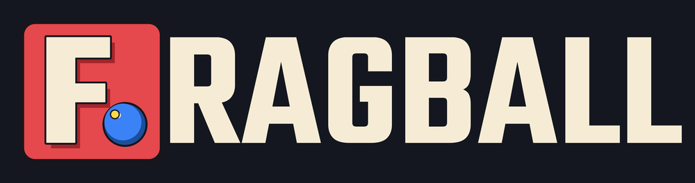
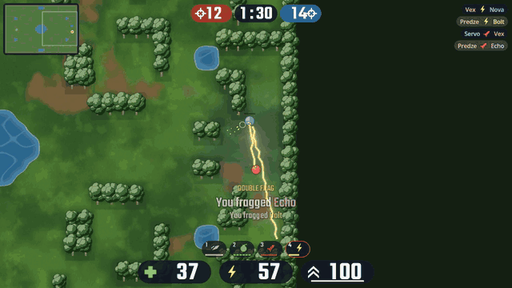

A top-down 4v4 arena shooter in the spirit of Babo Violent: capture the flag, team deathmatch, free for all
and king of the hill, against bots or friends.

## Download
Get the latest version from **[Releases](https://github.com/LarsSoeMikkelsen/fragball-releases/releases/latest)**:

- **Windows:** `fragball-<version>-windows.zip`. Unzip and run `fragball.exe`. The game isn't code-signed, so Windows may say
  "Windows protected your PC": click **More info → Run anyway**.
- **Linux:** `fragball-<version>-linux.zip`. Unzip and run `./fragball.x86_64`.

## Playing together
Everyone needs the same version.

- **Same network:** one player picks Multiplayer → Host; the others find the game in their Multiplayer list.
- **Over the internet:** the host forwards **UDP port 27960** on their router to their PC. The host's lobby shows
  their public address with a Copy button; the others paste it into Join.

This repository only holds the downloads.
